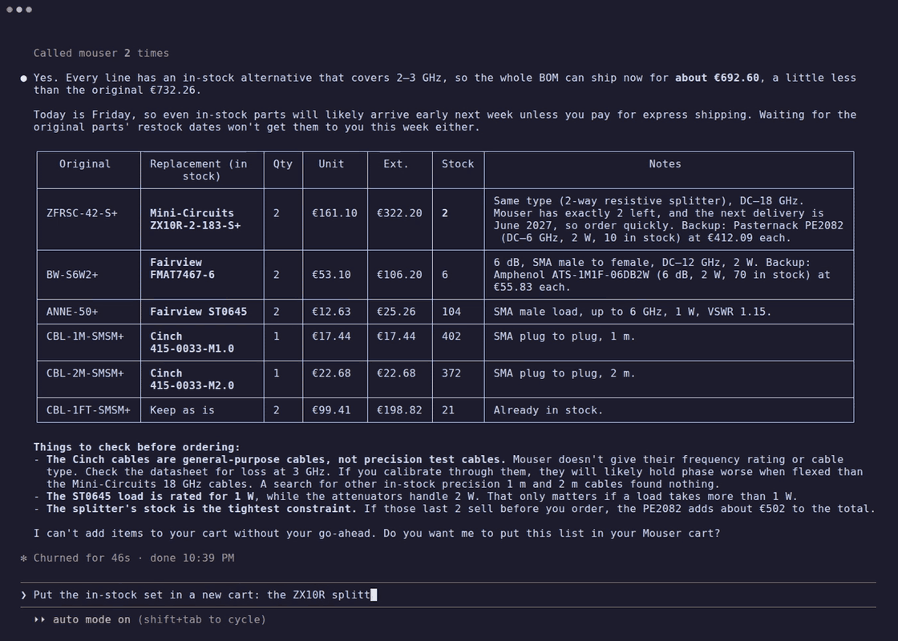

# mouser-mcp

[](https://github.com/eljefedelrodeodeljefe/mouser-mcp/actions/workflows/ci.yml)
[](LICENSE)
[](https://modelcontextprotocol.io)

**Let an AI agent price your BOM at Mouser: live stock, lead times and price breaks, carts,
order history, and orders that you confirm yourself.**



A Rust SDK (`mouser`) and an [MCP](https://modelcontextprotocol.io) server (`mouser-mcp`) for
the complete [Mouser API](https://www.mouser.com/api-hub/): every endpoint of Mouser's Swagger
documents, typed. Point Claude Code, Cursor or any MCP client at it and ask "is everything on
this BOM in stock, and what does it cost at these quantities?".

## Tools

Only the tools for the keys you configure are listed.

| Key | Tools |
|---|---|
| Search API key | `search_by_keyword`, `search_by_keyword_and_manufacturer`, `search_by_part_number`, `search_by_part_number_and_manufacturer`, `list_manufacturers`, **`price_bom`** |
| Cart and Order API key | carts: `get_cart`, `update_cart`, `add_cart_items`, `update_cart_items`, `remove_cart_item`, `insert_schedule_cart_items`, `update_schedule_cart_items`, `delete_all_schedule_cart_items`, `create_cart_from_order` |
| | history: `order_history_by_date_filter`, `order_history_by_date_range`, `get_order_by_sales_order_number`, `get_order_by_web_order_number`, `get_order` |
| | ordering: `query_order_options`, `list_order_currencies`, `list_order_countries`, `preview_order`, `submit_order`, `preview_order_from_order`, `submit_order_from_order` |

`price_bom` takes BOM lines (part number, quantity, your reference), looks them up ten per
call by exact part number, picks the offer that covers the quantity from stock at the lowest
extended price, prices it at the line's quantity from the price breaks, flags shortages,
minimum and multiple violations and discontinued parts, and totals per currency. Amounts are
exact decimals, read with each currency's own separators; a price or stock figure that does not
parse is flagged as unreadable on its line.

Search results are compact by default (stock, lead time, Min/Mult, price breaks, lifecycle,
URLs); `full: true` returns Mouser's whole record. The library keeps every field Mouser sends,
including ones its documents do not describe.

## Safety

Searching and reading change nothing. Changing a cart and placing an order each have their
own gate, and every order needs the person's confirmation:

1. **Cart changes** need `MOUSER_ALLOW_CART_WRITES=true`.
2. **Orders** need `MOUSER_ALLOW_ORDERS=true` **and** a ceiling, `MOUSER_MAX_ORDER_TOTAL`
   (in the order's currency). Without a ceiling no order is placed. The check is in the
   library, below the MCP layer.
3. `preview_order` always sends `SubmitOrder: false`, whatever the request says. Only
   `submit_order` sends `true`, and only after a **fresh preview** matches what the caller
   confirmed: currency, total and every line. If the price moved since the preview, nothing is
   placed and the caller gets an *invalid params* error explaining what changed.
4. **The person at the MCP client confirms every order in a form.** Before placing it, the
   server asks the person at the MCP client through [elicitation](https://modelcontextprotocol.io/specification/draft/client/elicitation).
   The form has a one-line summary (total, shipping, tax, payment, ship-to), "Order lines",
   a list of every line (quantity, part, unit price, line total, your line reference) with all
   of them selected, and "Place this order", a checkbox, unticked. Clients step through the
   list with the keyboard, so a long order stays readable. Only an accepted form with every
   line still selected and the box ticked places the order, and only if Mouser's final preview
   still has the lines confirmed; deselecting a line, declining, cancelling or not
   answering places nothing. A client that cannot show forms cannot order. On protocol
   `2026-07-28` the form travels as an `InputRequiredResult` (multi round-trip); the pending
   confirmation stays on the server, is single use, expires after ten minutes and is bound to
   the exact arguments of the call, so an answer cannot be replayed onto another order.

5. **No answer is not "nothing happened".** If the submission times out or the connection
   drops after it was sent, Mouser may have placed the order. The tool then fails with its
   own error (code `-32001`, "the order may have been placed") instead of a transport error,
   and says to look for the order (`order_history_by_date_filter` with `Today`, or
   `get_order`) before submitting again. The server never retries a submission.

An order takes four steps: `query_order_options` (shipping and payment codes),
`preview_order` (`cart_key`, `currency_code`, `shipping_code`, `payment_method`),
`submit_order` (the same, plus the preview's `total`), and the user's answer in the form.
A re-order of an earlier order takes the same arguments plus its `order_number`
(`preview_order_from_order`, `submit_order_from_order`). Neither takes an address or freight
accounts: those come from the Mouser account, so the model cannot send an order somewhere the
form does not show.

Keys travel in Mouser's query string, so the client never logs URLs, strips them from
transport errors, scrubs the key from any reply that echoes it, and redacts `ApiKey` in
`Debug`.

## Demo

Pricing a BOM from one prompt: stock, price breaks, and the line Mouser cannot deliver.


The confirmation form in Claude Code, captured from the [demo](demo/) (stand-in Mouser API,
demo data, nothing bought). The model prepared the cart and the preview; only the person can
answer this:

```text
MCP server "mouser" requests your input
Real order at Mouser: 533.78 EUR · 5 lines · merchandise 493.78 · UPS Worldwide Express Saver 40.00 · tax 0.00 · PayPal · to Ada Lovelace Berlin DE
❯ ✔ Order lines: ▾
      ❯ ☒ "2 × ZX10R-2-183-S+  161.10 each  = 322.20 EUR"
        ☒ "2 × FMAT7467-6  53.10 each  = 106.20 EUR"
        ☒ "1 × 415-0033-M1.0  17.44 each  = 17.44 EUR"
        ☒ "1 × 415-0033-M2.0  22.68 each  = 22.68 EUR"
        ☒ "2 × ST0645  12.63 each  = 25.26 EUR"
      Everything in this order. Deselect any line to stop the order.
  ✔ Place this order: 533.78 EUR: ☐
      A real purchase, charged to the payment method above
  Accept    Decline
Esc to cancel · ↑/↓ to navigate · Backspace to unset · Space to toggle
```

[`demo/`](demo/) also has scripted terminal recordings ([VHS](https://github.com/charmbracelet/vhs))
of pricing a BOM and of an order confirmed in this form, against the same stand-in API, so
anyone can try the server without a Mouser account.

## Install

**With cargo:**

```sh
cargo install --locked --git https://github.com/eljefedelrodeodeljefe/mouser-mcp mouser-mcp
```

**From source:**

```sh
git clone https://github.com/eljefedelrodeodeljefe/mouser-mcp.git
cd mouser-mcp
cargo install --locked --path crates/mouser-mcp   # or: cargo build --release
```

Release binaries (Linux and macOS, x86_64 and aarch64, with SBOMs) are attached to
[Releases](https://github.com/eljefedelrodeodeljefe/mouser-mcp/releases).

## Keys

Mouser issues **two separate keys**, and each works only for its own API:

| Key | For | Where |
|---|---|---|
| **Search API** key | search, `price_bom` | <https://www.mouser.com/api-hub/>, under *Search API*: request it (it is not issued automatically) |
| **Cart and Order API** key | carts, order history, orders | the same page, *Manage APIs*: one key covers Order, Cart and Order History |

Both look like GUIDs (`xxxxxxxx-xxxx-xxxx-xxxx-xxxxxxxxxxxx`). Put each in its own file,
readable only by you:

```sh
mkdir -p ~/.config/mouser && chmod 700 ~/.config/mouser
$EDITOR ~/.config/mouser/search-api-key        # paste the key, one line
$EDITOR ~/.config/mouser/order-api-key         # optional: carts and orders
chmod 600 ~/.config/mouser/*-api-key
```

### Pitfalls

- **`Invalid (API Key): Invalid unique identifier.`** is what Mouser answers to a key used for
  the wrong API, as well as to a mistyped one. If *Manage APIs* shows Order, Cart and Order
  History next to your key, that is the Cart and Order key: the Search API needs its own.
- **The server reads the key files when it starts.** After changing one, restart the server
  (in Claude Code: `/mcp`, then reconnect `mouser`). An empty key file stops it from starting.
- **Calls are rate limited per key.** The server spaces them to
  `MOUSER_MAX_CALLS_PER_MINUTE` (30 by default); `price_bom` looks up ten lines per call.
- **Prices and currency follow your Mouser account's region** (mouser.de prices in EUR, for
  example); `price_bom` reports them per currency.
- **Ordering uses the account's defaults.** Shipping address, payment methods (PayPal, card,
  invoice terms) and VAT details come from your Mouser account; `query_order_options` lists
  what it offers. With a validated EU VAT number the preview can show no tax (reverse
  charge). Mouser fills in the order type (for example `Rush`: ship what is in stock first).
- **Ordering needs a client that shows MCP forms** (elicitation), as Claude Code does: the
  person confirms the order there. Without one, `submit_order` refuses.
- **"The order may have been placed"** means the submission went out and no answer came
  back. Check the order history (or Mouser's website) before you submit again: a second
  submission can place a second order.
- **API carts have their own `CartKey`.** Keep the key the tools return; whether an API cart
  also shows up in the website's basket has not been verified.

## Configure

**Claude Code:**

```sh
claude mcp add mouser --env MOUSER_SEARCH_API_KEY_FILE=$HOME/.config/mouser/search-api-key -- mouser-mcp
```

**Any MCP client (`.mcp.json` / `mcpServers`):**

```json
{
  "mcpServers": {
    "mouser": {
      "command": "mouser-mcp",
      "env": {
        "MOUSER_SEARCH_API_KEY_FILE": "/home/you/.config/mouser/search-api-key"
      }
    }
  }
}
```

| Variable | Default | Meaning |
|---|---|---|
| `MOUSER_SEARCH_API_KEY_FILE` / `MOUSER_SEARCH_API_KEY` | — | Search API key (file preferred) |
| `MOUSER_ORDER_API_KEY_FILE` / `MOUSER_ORDER_API_KEY` | — | Cart and Order API key |
| `MOUSER_ALLOW_CART_WRITES` | `false` | Enable cart changes |
| `MOUSER_ALLOW_ORDERS` | `false` | Enable `submit_order` / `submit_order_from_order` |
| `MOUSER_MAX_ORDER_TOTAL` | — | Order ceiling in the order's currency; required to order |
| `MOUSER_MAX_CALLS_PER_MINUTE` | `30` | Client-side spacing of calls (Mouser limits calls per key) |
| `MOUSER_TIMEOUT_MS` | `30000` | HTTP timeout |
| `MOUSER_API_BASE` | `https://api.mouser.com/api` | API root (tests and the demo) |

At least one key is required. The server logs to stderr at `info` unless `RUST_LOG` says
otherwise: each submission, each order placed (its id, total and currency, never the address)
and each refusal. `RUST_LOG=mouser=debug` also logs each call (never the key).

## Library

```rust
use mouser::{ApiKey, Client, Config, models::SearchByPartRequest};

let client = Client::new(Config {
    search_key: Some(ApiKey::from_file("/home/you/.config/mouser/search-api-key")?),
    ..Config::default()
})?;
let r = client
    .search_by_part_number(&SearchByPartRequest {
        mouser_part_number: Some(mouser::join_part_numbers(&["ZFRSC-42-S+".into()])?),
        part_search_options: Some("Exact".into()),
        ..Default::default()
    })
    .await?;
```

`cargo run -p mouser --example probe -- ZFRSC-42-S+` checks a live key with one read-only
search.

## Development

See [AGENTS.md](AGENTS.md). Gates: `prek run --all-files` (fmt, clippy `-D warnings`, tests,
typos, markdownlint). Tests run against a mock Mouser API (wiremock); nothing in the test
suite talks to Mouser.
